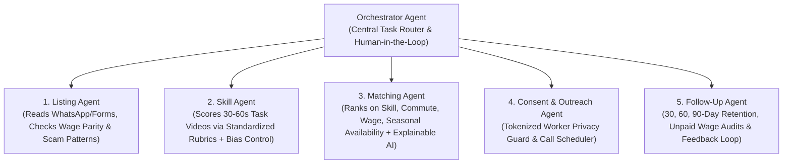

# Hunar Setu (हुनर सेतु / হুনর সেতু)
### *Verified skills. Trusted jobs.*
**Team The Bridge Coders · Jadavpur University**

Hunar Setu is an Agentic AI rural employment platform that matches rural youth with small local employers while eliminating fraud, hiring delays, and early exits.

---

## 🚀 How to Run Locally

### Option A: 1-Click Launchers
- **On Windows**: Double-click `start.bat`
- **On Linux / macOS**: Run `./start.sh`

### Option B: Manual Setup (Terminal)
1. **Clone or navigate to the directory**:
   ```bash
   cd hunar-setu
   ```

2. **(Optional) Create and activate a virtual environment**:
   ```bash
   python -m venv venv
   # On Windows:
   venv\Scripts\activate
   # On Linux/macOS:
   source venv/bin/activate
   ```

3. **Install Dependencies**:
   ```bash
   pip install -r requirements.txt
   ```

4. **Start the Web Application**:
   ```bash
   python run.py
   ```

5. **Open in Your Browser**:
   - Web App UI: **[http://127.0.0.1:8000](http://127.0.0.1:8000)**
   - Interactive Swagger API Docs: **[http://127.0.0.1:8000/docs](http://127.0.0.1:8000/docs)**

---

## 🤖 Five Agents & Orchestrator Architecture



### 1. Listing Agent (Before workers see anything)
- **Posting Ingestion**: Ingests new postings from WhatsApp messages, web forms, or village Panchayat kiosks.
- **Verification Checks**:
  - Employer phone & identity verification (GSTIN / MSME / Shop Act / Aadhaar).
  - Wage vs. local statutory district minimum wage floors (e.g. Purba Bardhaman, Bankura, Birbhum, Hooghly, Patna, Gaya).
  - Scam pattern keyword scan & advance-fee request blocking (`"registration fee"`, `"laptop security deposit"`).
- **Decision Engine**: `PUBLISH`, `HOLD_FOR_HUMAN_REVIEW`, or `REJECT`.

### 2. Skill Agent (Vision + Fixed Rubrics + Bias Control)
- **Task Demonstration**: Worker submits a 30-60 second video demonstrating a physical trade task (tractor hydraulics, solar inverter wiring, precision welding, mobile chip repair, masonry).
- **Standardized Rubric (4 Axes, 25 pts each)**:
  1. Technical execution (torque spec, spool valve pressure test, sequence).
  2. Safety and PPE compliance (gloves, helmet, eye shield).
  3. Tool handling and kinematics (grip, posture, proper tool selection).
  4. Efficiency and precision (cycle time, clean finish).
- **Bias Control Guard**: Model is strictly blinded to facial appearance, dress, dialect, and gender.
- **ITI Cross-check**: Optionally cross-checks trade qualifications against NCVT/SCVT ITI roll numbers.

### 3. Matching Agent (Multi-Factor Radar)
- **Inputs**: Skill score, distance (km), travel commute limit, minimum daily wage (e.g. ₹450/day), and seasonal availability (Immediate vs Post-Harvest).
- **Multi-Factor Score**: Skill Fit (40%) + Distance Fit (30%) + Wage Fit (20%) + Amenities (10%).
- **Explainable AI**: Plain-language justification translated and voice-synthesized in **Hindi**, **Bengali**, and **English** (*e.g. "6 km away, ₹450/day, matches your electrical skill."*).

### 4. Consent and Outreach Agent (Worker Privacy Guard)
- **Privacy Shield**: Worker contact info (`+91 98*** •••••`) is strictly withheld until explicit worker authorization.
- **Voice Briefing**: Asks the worker *"Share your details with this employer?"* in their mother tongue.
- **Outreach Automation**: Upon consent, messages the verified employer, unlocks contact exchange, and schedules an introductory interview call slot.

### 5. Follow-Up Agent (30, 60, 90-Day Retention)
- **Scheduled Milestones**: Automatic check-ins at 30, 60, and 90 days with both worker and employer.
- **Complaint & Retention Audit**:
  - Unpaid wage complaints / wage delays detection.
  - Recording why previous hires left (e.g. harsh conditions, broken promises).
- **Trust Score Feedback**: Positive retention boosts employer trust rating by +5%; unpaid wage violations heavily penalize employer ranking (-15%).

---

## 📁 Project Structure

```
hunar-setu/
├── app/
│   ├── __init__.py
│   ├── main.py                  # FastAPI application & REST endpoints
│   ├── config.py                # District wage benchmarks, scam phrases, trade rubrics
│   ├── models.py                # Pydantic data schemas (Job, Worker, Skill, Match, Followup)
│   ├── database.py              # In-memory repository with real-world pre-seeded data
│   ├── agents/
│   │   ├── __init__.py
│   │   ├── orchestrator.py      # Orchestrator & Human-in-the-Loop manager
│   │   ├── listing_agent.py     # Listing Agent (Scam detection & wage parity)
│   │   ├── skill_agent.py       # Skill Agent (Video evaluation & bias control)
│   │   ├── matching_agent.py    # Matching Agent (Ranking & Explainable AI)
│   │   ├── consent_agent.py     # Consent & Outreach Agent (Privacy guard)
│   │   └── followup_agent.py    # Follow-up Agent (30/60/90-day retention loop)
│   ├── static/
│   │   ├── css/styles.css       # Tailwind + custom rural-tech theme
│   │   └── js/
│   │       ├── app.js           # Interactive state & tab controller
│   │       ├── video_demo.js    # Kinematic video simulator & canvas
│   │       └── voice.js         # Text-to-Speech in Hindi, Bengali, English
│   └── templates/
│       └── index.html           # Full Single-Page Web Application
├── run.py                       # Python launcher script
├── test_app.py                  # 7/7 Multi-agent unit & integration test suite
├── start.bat                    # 1-Click Windows starter
├── start.sh                     # 1-Click Linux / macOS starter
├── requirements.txt             # Pip package dependencies
└── README.md                    # System documentation
```

---

## 🧪 Automated Testing
Run the automated multi-agent test suite:
```bash
python test_app.py
```
Output:
```
>>> 1. Initializing Orchestrator Agent...
✓ Orchestrator initialized.
>>> 2. Testing Listing Agent Verification (Legitimate Job)...
✓ Legitimate job verified: PASSED AUTOMATED AUDIT...
>>> 3. Testing Listing Agent Scam Detection (Fraud Advance Fee)...
✓ Scam detected and blocked: REJECTED BY LISTING AGENT...
>>> 4. Testing Skill Agent Video Assessment with Bias Control...
✓ Skill assessed: Certified Tractor Specialist - Score: 87.8/100
>>> 5. Testing Matching Agent...
✓ Top match: Hydraulic Mechanic (92.6% match score)
>>> 6. Testing Consent Agent Privacy Protocol...
✓ Consent granted. Contact unlocked: +91 98321 00000
>>> 7. Testing Follow-up Agent 30-60-90 Day Retention Milestones...
✓ Scheduled 3 retention milestones: [30, 60, 90] days.
✓ 30-day check-in processed. Trust impact: +4.0%
===========================================================
ALL MULTI-AGENT ARCHITECTURE TESTS PASSED SUCCESSFULLY! (7/7)
===========================================================
```

---

## 👥 Credits
**Hunar Setu** · *Verified skills. Trusted jobs.*  
Team The Bridge Coders · Jadavpur University
